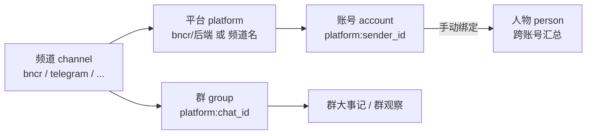
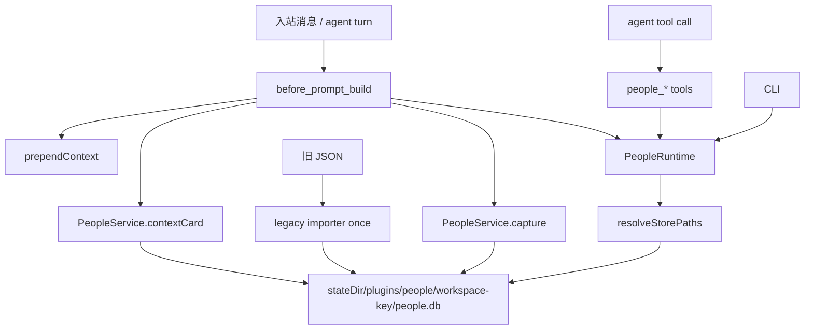

# People Memory 设计

## 目标

把「识人规则写在 28KB 提示词里」变成「运行时自动完成身份解析、上下文注入和受控写入」。

三个约束：

1. 数据边界是 agent 可见工作区，不是 agent id。
2. 频道无关，BNCR 只是其中一个来源。
3. SQLite 是主存储，JSON 只用于迁移和导出。

## 完整模型（三层键）



- 普通频道（telegram 等）没有平台层：频道名就是键，账号键 `telegram:<sender>`，群键 `telegram:<chat_id>`。
- bncr 是按平台方式接入的频道：一条接入里带多个后端（GewePlus、GolemPlus、qq、qqBot、tgBot、larkalk、wxBot）。合法账号键是 `bncr/<后端>:<sender>`；裸 `bncr:<sender>` 缺后端，是非法态，插件不新建裸行，存量裸行由周期任务清理。
- 同族只有配置声明的配对：默认 `senderFamilies=["bncr/GewePlus","bncr/GolemPlus"]`。它们是同一微信平台的两条接入，senderid 空间一致（同一 wxid 在两条接入里相同）。其它后端（qq、tgBot 等）即使同类，senderid 空间不同，无法同族归位。系统没有别名（alias）概念：GewePlus 与 GolemPlus 两条接入分开记录，不做账号互并。

## 两个维度与同族自动归并

- 账号维度：每个账号行独立记印象/特征。不同后端的同一 chat 群行也是独立记录，不算重复。
- 人物维度：`persons` 跨账号汇总。自动归并只发生在同族：
  - 同 sender 的 `bncr/GewePlus` 与 `bncr/GolemPlus` 两行 → 自动绑到同一个人物，人物吸收两侧印象/特征；
  - 两侧都未绑 → 自动创建人物（命名见下）并双侧绑定迁移；
  - 一侧已绑 → 新接入行出现时绑到同一个人物（仅写入路径触发；周期扫描不自动补绑，避免覆盖 owner 的解绑决定）；
  - 两侧绑到不同人物 → 不动数据，health 报 `person_binding_conflict`，周期任务出 merge_review 由 owner 判断；
  - 任一侧 `current_role=bot` → 整组跳过。
- 跨平台同人（比如 QQ 号 + 微信号是同一人）：不自动归并，只有 owner/agent 手动 `people_bind` 把多个平台账号收到一个人物下。

## 群模型

群独立于账号维度记大事：`group_events`（群规、里程碑、接口/功能变更）与 `group_observations`（长期观察）。每条群记录挂在具体后端下（`platform:chat_id`）；事实约束是「只有同族的两个不同平台 bot 才会出现在同一个群里」，所以不同后端的同 chat 行是两条独立记录，不做跨后端去重。同一条群规则如果需要在两个后端的群行里都有，由 agent 分别 `people_note` 两次。

## bot 与 agent 的身份

agent 在各平台以平台账号出现（例如 orion 同时有 bncr/GewePlus 行和 bncr/GolemPlus 行），这是天然的账号级绑定层：`current_role=bot` + 群 botNames 就是全部身份，不给 bot 建人物、不记 bot 印象。bot 账号命中群 botNames 或成员 likely_bot 分类时，repair 自动补 `current_role=bot`。

## 命名规则

显示优先级：`call_name`（本人钦定，自我介绍走 `people_name { call_name }`）> `confirmed_name`（自述名字）> 最近活跃行的平台昵称。人物级同名优先级。call_name 不被昵称同步覆盖；owner 解绑后系统不自动补绑已有人物，除非又出现新接入行。

## 隔离与共享（按工作区）

数据边界是 agent 可见工作区，不是 agent id。

- 默认数据目录 `<stateDir>/plugins/people/<workspace-key>/people.db`：`stateDir` 默认 `~/.openclaw`，可用 `OPENCLAW_STATE_DIR` 覆盖；`<workspace-key>` 由工作区真实路径编码。布局与 bncr 的 `<stateDir>/plugins/<id>` 一致。
- 同工作区（main 与 orion 共用同一个 workspaceDir，例如 `<workspace>`）：同一人格、同一记忆、同一份识人库 `<stateDir>/plugins/people/<workspace-key>/people.db`，天然共享，不需要链接。
- 不同工作区（例如 public = `<workspace>/public`）：独立库，严格隔离——不跨工作区读、不跨工作区写、不搬运人物记录。旧体系里「查不到时读另一个工作区库做辅助查询」的规则随 0.4.0 废除。
- 想留在工作区（例如沿用旧库）用 `dataDir: "{workspace}/people"` 覆盖；插件按数据目录 realpath 识别同一个库，符号链接等价于共用一个数据目录。
- 周期任务只处理本工作区的会话（home 任务只收 agent:main / agent:orion，public 任务只收 agent:public）。

## 分层



```
index.ts                 只做装配
src/core/                纯数据能力，不依赖 OpenClaw
  paths.ts               工作区 → 数据目录
  platform.ts            频道 → 平台标签
  schema.ts              SQLite schema
  db.ts                  连接、事务、查询、写入
  legacy.ts              旧 JSON 一次性导入
  service.ts             捕获、上下文卡片、记忆、绑定、同族归并、校验
src/plugin/              OpenClaw 适配
  config.ts              配置归一化
  runtime.ts             按 realpath 缓存数据库连接
  identity.ts            钩子上下文字段解析
  hooks.ts               inbound_claim / before_prompt_build / gateway_stop
  tools.ts               agent 工具
  cli.ts                 openclaw people ...
```

`src/core` 不 import OpenClaw，方便单测和独立复用。

## 数据模型

schema v2 起，`accounts` 与 `persons` 都有 `call_name` 列：本人钦定的称呼，优先于 `confirmed_name` 和平台昵称，不被昵称同步覆盖。旧库打开时自动 `ALTER TABLE` 补列。

| 表 | 主键 | 用途 |
|---|---|---|
| `accounts` | `account_id` | 账号索引，`platform:sender_id` |
| `persons` | `person_id` | 跨账号人物 |
| `person_accounts` | `account_id` | 绑定桥接 |
| `impressions` | 自增 id | 原始印象，按内容哈希去重 |
| `traits` | `(owner_type, owner_id, dimension)` | 归并后的维度 |
| `groups` | `group_id` | 群索引，`(platform_key, chat_id)` 唯一 |
| `group_members` | `(group_id, account_id)` | 群成员 |
| `group_events` | 自增 id | 群大事记，按天+摘要去重 |
| `group_observations` | 自增 id | 群长期观察 |
| `dimensions` | `key` | 特征维度配置 |
| `scan_channels` | `(workspace_key, channel_key)` | 扫描进度 |
| `scan_meta` | `workspace_key` | 全量扫描时间 |
| `meta` | `key` | schema 版本、迁移标记 |

`owner_type` 只有 `account` 和 `person`。绑定后，账号级 impressions/traits 会迁移到人物级，账号行只保留身份与时间戳。

## 写入纪律

| 写入者 | 允许写入 |
|---|---|
| 钩子 | 账号索引、显示名、最后活跃、群标题、群成员（`inbound_claim` 只缓存身份，不存正文） |
| 同族状态机 | 同族两行同 sender：自动建人物并双绑、或新行补绑到已有人物（只动绑定与迁移，不猜内容） |
| agent 工具 | impressions、traits、群事件、绑定、删除 |
| 工作区周期任务 | 先调 `people_cycle` 获取插件维护计划，再通过 `people_remember` / `people_note` / `people_scan_mark` / `people_merge` 写 |
| owner | 绑定、修复、人物合并判断 |

所有写操作走同一个 `PeopleDatabase`，事务用 `BEGIN IMMEDIATE`，嵌套调用自动降级为 savepoint。SQLite 开 WAL、`busy_timeout=5000`，允许多进程读写。

## 频道抽象

平台标签：

```
platform = template({channel}, {account})
```

- 默认模板 `{channel}/{account}`；没有有效 account 时退化为 `{channel}`。
- `default / main / primary / 0` 视为无账号。
- `platformOverrides` 可按频道覆盖模板。
- 多后端频道（默认 bncr，配置 `multiAccountChannels`）：账号键必须带后端段；裸频道写入挂起（deferred），不建裸行、不建裸群行。
- 比较时 `bncr/tgBot` 与 `bncr:tgBot` 等价，兼容旧数据。
- 同族关系来自 `senderFamilies` 配置（平台标签两两配对），与别名无关。

群 key 保持旧格式：`platform.replace('/', ':') + ':' + chatId`。同一 chat 在不同后端下是不同群行，按行独立维护；按 chat 号查群命中多后端行时工具报歧义，用精确群 key 指定。

## 旧数据适配

线上 JSON 与 SPEC 有四处偏差，导入器逐一兼容：

| 偏差 | 处理 |
|---|---|
| `groups.json` 外层包 `groups` | 自动识别平铺/包装 |
| `scan-state.channels` 是 dict | 同时支持 dict 与数组 |
| `impressions[]` 是字符串 | 字符串与对象都支持 |
| 群文件新旧双命名 | 按 `platform + chat_id` 去重合并 |

群记忆条目支持 `summary`、`event`、`title`、`content`，并拼接 `detail/description/note`。历史裸平台行（如 `GewePlus:wxid_...`）随导入原样进库，由周期任务的裸行清理归位到带后端的行。

## 失败策略

- 钩子异常：捕获、记警告、返回 `undefined`，不影响对话。
- 旧 JSON 导入异常：捕获、记警告，数据库保持可用；不会删除旧文件。
- 工具异常：向模型返回明确中文错误，不静默成功。
- 数据库损坏：CLI `validate` 报告；修复只处理缺失人物/账号/绑定同步、裸行清理、同族自动建人物，不猜内容。人物绑定冲突不自动修，交 owner。

## 扩展点

- 新频道：优先靠 `platformOverrides` 和上下文字段候选；仍不匹配时在 `identity.ts` 增加候选键。
- 新同族配对：`senderFamilies` 配置里加一对平台标签即可，代码不动。
- 新维度：直接写 `dimensions` 表，或在 `schema.ts` 的 `DEFAULT_DIMENSIONS` 增加默认项。
- 新工具：在 `tools.ts` 注册，manifest 的 `contracts.tools` 同步。
- 导出/备份：`people_backup` 同时产出 SQLite 与 JSON 快照。

## 周期闭环

定时器只负责叫醒 agent。备份、校验、安全修复、同族归并、裸行清理、健康检查和维护待办由 `people_cycle` 统一执行。agent 负责语义归并和基于证据的人物合并，不能绕过 `people_*` 直接改库。同族冲突（绑到不同人物）以 `merge_review` 形式进待办，owner 判断后才动数据。
