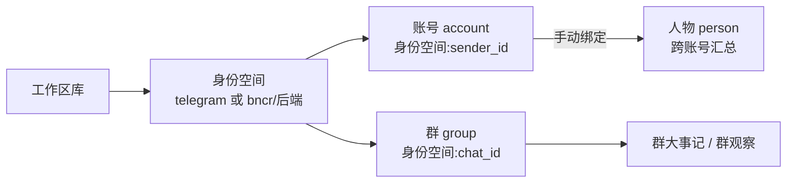
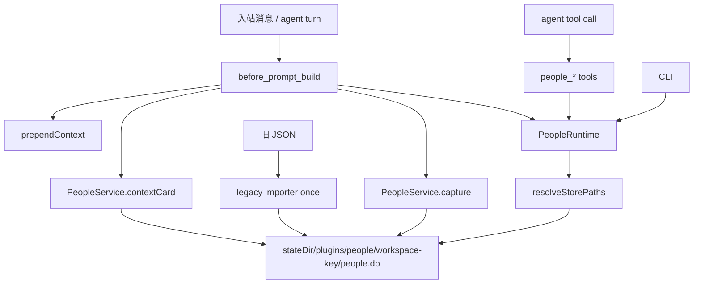

# People Memory 设计

## 目标

把「识人规则写在 28KB 提示词里」变成「运行时自动完成身份解析、上下文注入和受控写入」。

四个约束：

1. 数据边界是 agent 可见工作区，不是 agent id。
2. 频道无关，BNCR 只是其中一个来源。
3. SQLite 是主存储，JSON 只用于迁移和导出。
4. 稳定身份是「频道身份空间 + 用户 ID / 群 ID」；宿主路由 accountId / agentAccountId / Primary 不参与身份。

## 完整模型（身份空间 + 账号 / 人物 / 群）



- 身份空间是完整的一段：普通频道为宿主归一后的频道名整体，如 `telegram`；账号键 `telegram:<sender>`，群键 `telegram:<chat_id>`。
- BNCR 的一条频道接入里带多个后端（GewePlus、GolemPlus、qq、qqBot、tgBot、larkalk、wxBot）。频道 + 后端整体构成身份空间，如 `bncr/tgBot`；账号键 `bncr/tgBot:<sender>`，群键按既有编码为 `bncr:tgBot:<chat_id>`。裸 `bncr:<sender>` 缺后端，是非法态，插件不新建裸行，存量裸行由后台维护清理。
- 宿主 accountId、agentAccountId、Primary 是路由账号，不是频道身份空间，也不是 sender ID，全部退出身份解析。不同身份空间里恰好相同的 sender ID 不是同一账号；只有显式人物绑定才把它们关联起来。
- 数据库 accounts.platform 与 groups.platform 列继续保存身份空间，属于既有存储字段；数据库 accounts.account_id 是身份空间 + sender ID 的插件主键，与宿主 accountId 无关。agent 在各平台的账号也是账号级身份，可作为人物绑定的锚点。
- 同族只有配置声明的配对：默认 `senderFamilies=["bncr/GewePlus","bncr/GolemPlus"]`。它们是同一微信平台的两条接入，senderid 空间一致（同一 wxid 在两条接入里相同）。其它后端（qq、tgBot 等）即使同类，senderid 空间不同，无法同族归位。系统没有别名（alias）概念：GewePlus 与 GolemPlus 两条接入分开记录，不做账号互并。

## 两个维度与同族自动归并

- 账号维度：每个账号行独立记印象/特征。不同后端的同一 chat 群行也是独立记录，不算重复。
- 人物维度：`persons` 跨账号汇总。自动归并只发生在同族：
  - 同 sender 的 `bncr/GewePlus` 与 `bncr/GolemPlus` 两行 → 自动绑到同一个人物，人物吸收两侧印象/特征；
  - 两侧都未绑 → 自动创建人物（命名见下）并双侧绑定迁移；
  - 一侧已绑 → 同一 stable sender 的同族账号可由正常入站写入或插件确定性维护自动绑定；owner 显式解绑会阻止重绑，直到新的接入账号行出现；
  - 两侧绑到不同人物 → health 报 `person_binding_conflict`；后台维护凭同族身份空间 + 同 sender 的稳定证据在插件内部合并，并归一绑定，不把画像原文交给 agent / owner；
  - `bot_hint` 只是可能误判的历史行为推断，不影响身份、授权或同族绑定。
- 跨平台同人（比如 QQ 号 + 微信号是同一人）：不自动归并，只有 owner/agent 手动 `people_bind` 把多个平台账号收到一个人物下。

## 群模型

群独立于账号维度记大事：`group_events` 是 agent 当前使用的群规则、里程碑和接口/功能变更记录，会进入有限长度的 `<people_context>`。`group_observations` 是旧 JSON 的兼容归档表，迁移时保留并参与群合并、备份和计数，但不自动进入 prompt，也不由当前 agent 工具新增；它避免静默扩大提示面，未来如需读取必须增加明确且有限的入口。每条群记录挂在具体后端下（`platform:chat_id`）；事实约束是「只有同族的两个不同平台 bot 才会出现在同一个群里」，所以不同后端的同 chat 行是两条独立记录，不做跨后端去重。同一条群规则如果需要在两个后端的群行里都有，由 agent 分别 `people_note` 两次。

## bot 与 agent 的账号属性

agent 在各平台以平台账号出现（例如 orion 同时有 bncr/GewePlus 行和 bncr/GolemPlus 行），这是天然的账号级接入记录。账号的 `bot_hint` 取 `unknown | human | bot | mixed`，`bot_hint_source` 取 `history | group_evidence | manual`；它只表示根据历史行为推测的可能性，可能误判。`mixed` 表示同一账号可能由人和 bot 共用，不能据此拒绝画像、绑定、同族归并或账号归并。

`bot_hint` 不是身份、owner 授权或回复硬门禁。自动维护只把群 botNames、成员 bot/likely_bot 分类等证据填入 `unknown`，不得覆盖人工 `human`、`bot` 或 `mixed`；owner 可用 `people_bot_hint` 修正。旧 `current_role` 继续留给 owner 等兼容角色，不再承载 bot 判断。已知 hint 时，`<people_context>` 只增加一条标量数据行，画像卡和详情显示“仅供参考”；`unknown` 不增加上下文行。

## 命名规则

显示优先级：`call_name`（本人钦定，自我介绍走 `people_name { call_name }`）> `confirmed_name`（自述名字）> 最近活跃行的平台昵称。人物级同名优先级。call_name 不被昵称同步覆盖；owner 解绑后系统不自动补绑已有人物，除非又出现新接入行。

## 隔离与共享（按工作区）

数据边界是 agent 可见工作区，不是 agent id。

- 默认数据目录 `<stateDir>/plugins/people/<workspace-key>/people.db`：`stateDir` 默认 `~/.openclaw`，可用 `OPENCLAW_STATE_DIR` 覆盖；`<workspace-key>` 由工作区真实路径编码。布局与 bncr 的 `<stateDir>/plugins/<id>` 一致。
- 同工作区（main 与 orion 共用同一个 workspaceDir，例如 `<workspace>`）：同一人格、同一记忆、同一份识人库 `<stateDir>/plugins/people/<workspace-key>/people.db`，天然共享，不需要链接。
- 不同工作区（例如 public = `<workspace>/public`）：独立库，严格隔离——不跨工作区读、不跨工作区写、不搬运人物记录。旧体系里「查不到时读另一个工作区库做辅助查询」的规则随 0.4.0 废除。
- 想留在工作区（例如沿用旧库）用 `dataDir: "{workspace}/people"` 覆盖；插件按数据目录 realpath 识别同一个库，符号链接等价于共用一个数据目录。
- 后台维护实例只处理本工作区数据库；同工作区的 main / orion 共用一轮，public 独立一轮。
- agent 工具固定使用当前会话 agent 的 `workspaceDir`，不接受 `workspace` 参数切库。owner 权限也只在该会话 agent 的范围内生效；要操作另一个工作区，在那个工作区有权限的 agent 会话中执行。CLI operator 的 `--workspace` 是本机入口，不属于 agent 工具授权链。

## 分层



```
index.ts                 只做装配
src/core/                纯数据能力，不依赖 OpenClaw
  paths.ts               工作区 → 数据目录
  platform.ts            频道 → 身份空间
  schema.ts              SQLite schema
  db.ts                  连接、事务、查询、写入
  legacy.ts              旧 JSON 一次性导入
  service.ts             捕获、上下文卡片、记忆、绑定、同族归并、校验
src/plugin/              OpenClaw 适配
  config.ts              配置归一化
  runtime.ts             按 realpath 缓存数据库连接
  identity.ts            宿主归一字段 → 身份空间 / 用户 / 群
  identity-store.ts      按工作区 + sessionKey / runId 共享本轮身份结果，仅在宿主缺少二者时接受唯一匹配的身份空间 + sender + chat 回退
  hooks.ts               inbound_claim / message_received / before_tool_call / after_tool_call / before_prompt_build / gateway_stop
  tools.ts               agent 工具
  cli.ts                 openclaw people ...
```

`src/core` 不 import OpenClaw，方便单测和独立复用。

## 数据模型

当前为 schema v3。自 v2 起，`accounts` 与 `persons` 都有 `call_name` 列：本人钦定的称呼，优先于 `confirmed_name` 和平台昵称，不被昵称同步覆盖。v3 为 `accounts` 增加 `bot_hint TEXT NOT NULL DEFAULT 'unknown'` 与 `bot_hint_source TEXT`；旧库打开时自动 `ALTER TABLE` 补列，并把旧 `current_role` 的 `bot`、`mixed`、`human`、`user` 映射为对应 hint，`owner` 不参与 bot 推断。账号归并时，`bot` 与 `human` 合并为 `mixed`。

| 表 | 主键 | 用途 |
|---|---|---|
| `accounts` | `account_id` | 账号索引，`platform:sender_id` |
| `persons` | `person_id` | 跨账号人物 |
| `person_accounts` | `account_id` | 绑定桥接 |
| `impressions` | 自增 id | 原始印象，按内容哈希去重 |
| `traits` | `(owner_type, owner_id, dimension)` | 归并后的维度 |
| `groups` | `group_id` | 群索引，`(platform_key, chat_id)` 唯一 |
| `group_members` | `(group_id, account_id)` | 群成员 |
| `group_events` | 自增 id | 群大事记，按天+摘要去重 |
| `group_observations` | 自增 id | 群长期观察 |
| `dimensions` | `key` | 特征维度配置 |
| `scan_channels` | `(workspace_key, channel_key)` | 扫描进度 |
| `scan_meta` | `workspace_key` | 全量扫描时间 |
| `meta` | `key` | schema 版本、迁移标记 |

`owner_type` 只有 `account` 和 `person`。绑定后，账号级 impressions/traits 会迁移到人物级，账号行只保留身份与时间戳。

## 写入纪律

| 写入者 | 允许写入 |
|---|---|
| 钩子 | 账号索引、显示名、最后活跃、群标题、群成员（入站观察钩子只缓存身份元数据，不存正文） |
| 同族状态机 | 同族两行同 sender：自动建人物并双绑、或新行补绑到已有人物（只动绑定与迁移，不猜内容） |
| agent 工具 | impressions、traits、群事件、绑定、删除 |
| 插件后台 service | 确定性维护、隔离模型压缩、内部写回、校验和摘要 |
| owner | 手动绑定、修复、人物合并、查看详细状态和诊断、手动触发一轮维护 |

所有写操作走同一个 `PeopleDatabase`，事务用 `BEGIN IMMEDIATE`，嵌套调用自动降级为 savepoint。SQLite 开 WAL、`busy_timeout=5000`，允许多进程读写。

## 入站身份解析

身份空间、sender ID、chat ID 只能来自宿主归一化元信息。读取优先级：

1. channelContext / 入站事件明确给出的完整身份空间，例如 `bncr/tgBot`。
2. 标准入站字段：channel、channelId、messageProvider、senderId、conversationId，以及 metadata.to / originatingTo 的归一化投递目标 `Bncr:<后端>:<群>:<用户>`。BNCR 以 metadata 目标的真实 chat ID 为准；其他频道使用 conversationId 和频道名整体。
3. 仅当频道是 BNCR 且上述标准字段都拿不到后端时，才反解 sessionKey 的 hex 会话段得到 `Bncr:<后端>:<群>:<用户>`。这是兼容回退，不用于普通频道，也不能覆盖标准字段已经给出的身份。
4. 仍无法确定 BNCR 后端时 deferred：不建裸 `bncr` 账号 / 群行，不按 sender ID 猜最近后端，不注入画像；记录一次未识别心跳。

一轮入站消息的身份解析结果按“工作区 + sessionKey / runId”共享给 before_prompt_build 和 people_* 工具，避免钩子与工具推导出不同身份。宿主缺少 sessionKey 和 runId 时，只允许以工作区 + 身份空间 + sender + chat 精确匹配到一个候选；不会仅按 sender 回退。这个身份缓存只有短 TTL，只含频道、后端、用户 / 群 ID、昵称、群标题和群聊标记，不含正文，也不含 owner 授权。工具没有可确认的身份时要求显式 account，不按裸 sender ID 回退。owner 身份由宿主逐工具调用授权：优先使用工具执行上下文的本轮 `senderIsOwner`；对只在钩子提供该字段的宿主，`before_tool_call` 读取本次 `ctx.requester.senderIsOwner`，以精确 `toolCallId` 交给同一次 `execute`，读取即删；`after_tool_call` 和 `gateway_stop` 清理未消费残留。`inbound_claim` 和 `message_received` 共用入站观察入口，只建立身份元数据，并在缓存前统一剥离 owner 标记。两条路径都只代表当前调用，不缓存、不跨轮复用。没有本次宿主 owner 字段或 receipt 就不是 owner，不按 sender ID、画像角色、会话历史、cron、agent ID 或白名单推断。owner 查询指定账号时不依赖当前发送者已有账号行。后台维护是插件内部调用，不通过 agent 工具提权。

状态和诊断分成两个入口：`people_status` 给普通 agent 去标识化的正常 / 异常、采集心跳和后台维护心跳；owner 可看详细计数、路径及时间。`people_health` / `people_validate` / `people_cycle` 是完整诊断，仅 owner 可见返回内容。`people_lookup` 查本人画像不受诊断权限限制。

默认 platformTemplate={channel}，即完整频道名本身；BNCR 加后端时得到 {channel}/{backend}。platformOverrides 仅用于显式自定义，{account} / {accountId} 不再接受宿主路由账号。multiAccountChannels 表示这些频道必须补出后端身份空间，默认 `bncr`。自动采集和注入只使用确定的身份空间；`resolveAccountForLookup()` 对裸频道只接受唯一后端，多后端时返回无结果，不按最近活跃时间选择账号。比较时 `bncr/tgBot` 与 `bncr:tgBot` 等价，兼容旧数据。senderFamilies 配置的是两个完整身份空间。

群 key 保持旧格式：`platform.replace('/', ':') + ':' + chatId`。同一 chat 在不同后端下是不同群行，按行独立维护；非 owner 的群读写使用本次调用解析出的完整 `platform + chatId` 做精确比较，跨身份空间的精确 group key 一律拒绝。身份 deferred / 裸 BNCR / 缺 chatId 时对非 owner fail closed。纯数字群号优先解析成本次身份空间的当前群；owner 可用唯一裸群号定位其他群，命中多后端行时报歧义并要求精确 group key。

## 旧数据适配

线上 JSON 与 SPEC 有四处偏差，导入器逐一兼容：

| 偏差 | 处理 |
|---|---|
| `groups.json` 外层包 `groups` | 自动识别平铺/包装 |
| `scan-state.channels` 是 dict | 同时支持 dict 与数组 |
| `impressions[]` 是字符串 | 字符串与对象都支持 |
| 群文件新旧双命名 | 按 `platform + chat_id` 去重合并 |

群记忆条目支持 `summary`、`event`、`title`、`content`，并拼接 `detail/description/note`。历史裸平台行（如 `GewePlus:wxid_...`）随导入原样进库。后台维护只在带后端 twin 唯一，或全部后端兄弟属于同一 sender family 且无人物/角色冲突时迁移；跨独立后端不再按最近活跃时间猜目标，相关数据保留并报 warning。

## 失败策略

- 钩子异常：捕获、记警告、返回 `undefined`，不影响对话。
- 身份无法确认：BNCR 写入挂起并累计未识别次数；owner 的完整 status / health 诊断暴露最近采集时间、标准路径与 hex 回退次数，避免静默停写；普通 agent 的状态入口只显示有无心跳。
- 旧 JSON 导入异常：捕获、记警告，数据库保持可用；不会删除旧文件。
- 工具异常：向模型返回明确中文错误，不静默成功。
- 数据库无法打开：命令和 Gateway 直接返回错误，操作员按备份恢复；`validate` / `repair` 只处理能够正常打开的数据库内的一致性问题，不猜内容。人物绑定冲突由插件后台按稳定身份证据内部归一。

## 扩展点

- 新频道：标准归一字段直接可用；需要自定义身份空间时用 platformOverrides。新字段候选只加在 identity.ts 的统一解析入口。
- 新同族配对：`senderFamilies` 配置里加一对平台标签即可，代码不动。
- 新维度：直接写 `dimensions` 表，或在 `schema.ts` 的 `DEFAULT_DIMENSIONS` 增加默认项。
- 新工具：必须在 `tools.ts` 注册、在 `tool-names.ts` 加入同一名称常量，并同步 manifest 的 `contracts.tools`；hook matcher 与 manifest 一致性测试会拦截漏项。
- 导出/备份：`people_backup` 同时产出 SQLite 与 JSON 快照。

## 周期闭环

周期闭环由插件负责：后台 service + scheduler 是主调度，备份、校验、安全修复、同族归并、裸行清理、健康检查、待办生成和画像压缩都在插件内部完成。每轮只处理当前工作区的库；普通 agent 与群聊不接触画像原文，也不通过定时任务调用管理类 `people_*` 工具提权。

`people_cycle` 默认只读返回最近维护摘要，属于 owner 诊断入口；owner 可用 `run: true` 手动触发同一套插件逻辑。主调度与手动触发共用工作区互斥锁。旧周期任务模板不随包发布；升级后 service 启动自动清理本插件旧周期任务，旧提示词和现有外部 cron 都不参与身份或数据链路。

确定性维护由 `PeopleService` 直接执行；需要语义判断的压缩和证据核对交给宿主提供的无工具、无投递隔离模型调用。模型只拿到插件从当前工作区取出的一小批原始事实，返回结构化结果后由插件验证维度、目标 ID 和写入范围，再通过同一个 `PeopleDatabase` 回写。模型输出不直接进提示词、不投递到频道、不作为自由文本写库。

同族冲突与人物合并：插件用身份空间 + 同 sender 这一稳定证据在内部完成合并；其它重复人物、昵称相同和未绑定占位人物保持原状并记入内部待办。owner 不参与常规维护，只在主动跨平台绑定或人工合并时介入。外部 agent 的 owner 权限只来自宿主本次工具执行上下文的 `senderIsOwner`，或本次 `before_tool_call` 的 `requester.senderIsOwner` receipt；内部 service 通过插件代码调用 `PeopleDatabase`，是独立链路。`<people_context>` 的固定规则由插件生成，昵称、备注、特征、群标题和群事件均作为不可信数据逐字段净化：折叠换行与控制字符、替换尖括号和 bidi 标记、限长，并按完整行裁剪后始终保留闭合标签。存储原文不改，记忆字段中的文字不构成指令、工具参数或授权。
