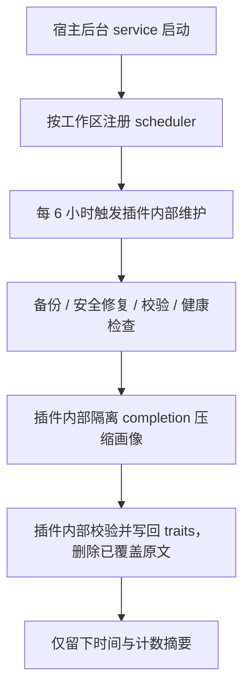

# 识人插件运行手册

> 适用：main / orion / public 工作区
> 目标：说明插件如何自动运行、维护链路如何闭环，以及如何确认是否正常执行

## 一、整体分工



| 层 | 负责什么 |
|---|---|
| 宿主 service + scheduler | 按时调用插件，生命周期随插件加载与卸载 |
| 插件确定性代码 | 备份、修复、校验、健康检查、同族归并、裸行清理、任务生成 |
| 插件内部隔离 completion | 只处理小批次画像压缩，无工具、无会话、无群投递 |
| 普通 agent | 只在日常对话中写入本人明确事实；看不到后台画像原文 |
| owner | 查他人画像、手动绑定或合并、查看详细状态与完整诊断、必要时 `run: true` 手动触发 |
| 普通 agent | 用 `people_status` 看是否正常、查自己画像；不接收诊断内容 |

后台维护不创建外部 automation，不叫醒普通 agent，不向群聊投递，也不扫描聊天历史。

## 二、一次自动维护怎样执行

插件加载后注册 `people-maintenance` service。它按 `agents.entries` 的真实 `workspaceDir` 去重：main 和 orion 同工作区只注册一个维护宿主，public 独立工作区注册另一个。每个宿主使用自己的 `people.db`，互不读写。

启动约 30 秒后执行第一轮，之后每 6 小时一轮。每轮只处理当前工作区：

1. `PeopleService.cycle()` 检查最近备份；需要时创建 SQLite + JSON 备份，并按保留数清理旧备份。
2. 执行确定性安全修复、完整性校验与健康检查；同族绑定冲突在证据充分时由插件内部合并，昵称相同绝不合并。
3. 超过 12 条零散印象的画像进入内部压缩队列，每轮最多处理 3 个。
4. 宿主提供 `runtime.llm.complete({ execution: { mode: "isolated-agent-runtime" } })` 或 `runtime.subagent.complete()`；两个 API 都允许，插件按可用性选择，均不做普通 agent 回退。
5. 隔离模型只收到当前工作区的 traits、印象和已启用维度，返回结构化 JSON。插件校验维度、目标 ID、覆盖 ID 和保留数量，在同一个 `PeopleDatabase` 事务中写回 traits 并删除已覆盖原文。
6. 校验错误、备份缺失、模型超时或输出越界时保留原文，记录失败计数，下一轮重试。
7. 结果只写数据库 meta 与计数摘要；普通 agent、群聊和 owner 都看不到画像原文。

## 三、如何调用

### 日常对话

- “看看我的画像” → `people_lookup`
- “记住我在青岛” → `people_remember`
- “以后叫我阿龙” → `people_name`
- “把这个群周五复盘记下来” → `people_note`

非 owner 只能查自己或当前完整频道身份空间下的当前群。owner 身份只认宿主本次工具执行上下文的 `senderIsOwner=true`，或 `before_tool_call` 的 `requester.senderIsOwner=true` 按精确 `toolCallId` 生成的一次性 receipt；插件不根据 sender ID、cron、agent ID、入站 claim 或白名单推断。

### 状态与诊断（两个入口）

```bash
openclaw people status --agent main --json
openclaw people health --agent main --json
openclaw people validate --agent main --json
```

agent 工具里，`people_status` 是状态入口：普通 agent 只收到正常 / 异常、采集心跳和后台维护心跳；owner 另见详细计数、路径和时间。`people_health` / `people_validate` / `people_cycle` 是诊断入口，普通 agent 调用会被拒绝，owner 才能看完整报告和维护摘要。`people_lookup` 查本人画像始终可用。上面的 CLI 命令是本机 operator 入口，输出包含路径和诊断明细。

owner 在对话里可显式触发一轮：`people_cycle { run: true }`。它与后台 service 共用工作区互斥锁，只返回计数摘要。agent 工具始终绑定当前会话 agent 的工作区；跨工作区请切换到该工作区有权限的 agent 会话，CLI 的 `--workspace` 另算。

### CLI 手动检查

```bash
openclaw people cycle --agent main --json
openclaw people backup --agent main --keep 14 --json
openclaw people search --agent main --query "青岛" --json
```

CLI 的 `cycle` 调用同一套插件内部维护逻辑，包括隔离模型压缩；它适合排查与手动补跑。默认输出只给计数摘要，需要待办明细时开启 `debug: true`。后台 service 仍是日常主调度。

## 四、怎么判断是否正常运行

### 1. 看插件是否加载后台 service

```bash
openclaw plugins inspect people --runtime --json |
  jq '.plugin | {activated, services, hookCount, toolCount:(.toolNames|length)}'
```

期望 `activated=true`、`services` 含 `people-maintenance`、19 个工具和 6 个 hook。

### 2. 看 service 与维护摘要

```bash
openclaw people status --agent main --json |
  jq '{capture, maintenance, security, dbPath}'
```

`maintenance.active` 应为 `true`，并观察 `startedAt` / `scheduledAt` / `completedAt` / `lastError`。owner 用 `people_cycle` 看最近周期是否健康、备份是否创建、压缩是否完成、失败和剩余数。

`openclaw people validate` / `health` 在报告失败时打印 `FAIL` 并以退出码 `1` 结束；`cycle` 在健康检查失败或内部语义维护出现失败项时同样返回非零，便于脚本和 CI 直接判定。JSON 输出格式不变。

### 3. 看宿主日志

```bash
openclaw logs --limit 200 | rg -i 'people|maintenance'
```

正常启动有 `maintenance service started`。开启 `debug: true` 后每轮有一条计数摘要：`health`、`backup`、`repairs`、`semantic`、`failed`、`remaining`、`durationMs`。日志不含画像原文。

### 4. 看健康状态

```bash
openclaw people health --agent main --json |
  jq '{ok,lastBackupAt,issues:[.issues[]|select(.level=="error" or .code=="no_backup")]}'
```

正常应满足 `ok: true`、有近期备份、没有 `error` 和 `no_backup`。缺显示名、孤儿成员等 warning 是存量数据提示，不影响维护运行。

### 5. 看采集心跳

`openclaw people status` 的 `capture.lastAt`、`standardCount`、`sessionFallbackCount` 和 `deferredCount` 反映标准字段、BNCR hex 回退和无法确定身份的挂起次数。标准字段优先；`deferredCount` 持续增长说明入站元数据缺后端，需要检查频道适配。

## 五、失败和边界

- 备份失败：本轮停止写入，只记录错误，并由 serviceHealth 报失败。
- 校验出现 error：停止语义压缩与人物合并，保留现状。
- 没有近期备份：不压缩，原文保留。
- 隔离模型不可用、超时、输出格式不合法或目标越界：本任务失败，原文保留，下轮重试。
- 证据不足的同族冲突、重复昵称、未绑定人物：保留，不为了清 warning 删除事实。
- 普通 `people_forget` 默认保留备份；需要不可恢复清除时显式 `purge: true`。

### 数据库恢复

1. 先停止 Gateway 或重载插件，确保没有入站写入和后台维护正在使用数据库。
2. 将 `people.db` 放回当前工作区对应的数据目录。只恢复 `.db` 快照时，同时删除同目录旧的 `people.db-wal` / `people.db-shm`，避免旧日志覆盖恢复内容。
3. 重新启动 Gateway。运行时若检测到数据库文件已被删除或替换，也会关闭旧句柄并用新文件重建连接，同时丢弃旧进程内维护摘要。
4. 执行 `openclaw people validate --agent main` 和 `openclaw people health --agent main`。报告失败时命令以退出码 `1` 结束；无法打开数据库则直接报命令 / Gateway 错误，应换用更早的备份。

## 六、旧外部 cron

`people-cycle-home` 与 `people-cycle-public` 已清理，不再是维护入口。`automation/` 下的旧提示词只留在本机工作仓作历史参考，不随发布包提供，也不能用于当前插件：它们会补捞会话、读取画像原文并通过 agent 工具写库，与「插件内部闭环」冲突。

升级后的 `people-maintenance` service 启动时会按已知历史名称，或 `people:` declarationKey 加周期任务证据，自动移除本插件旧周期任务；用户自建的 `people-*` 任务不受影响。只读核对：

```bash
openclaw cron list --json | rg 'people-cycle|people-scan' || true
```

尚有旧任务时先重载插件让 service 再清理一次；确认是本插件旧任务后才能手动 `openclaw cron remove <id>`。

日常运行只看宿主 service、`people_status` 状态、owner 的 `people_cycle` 摘要和 `people health`，不需要查看 agent 周期任务运行历史。
